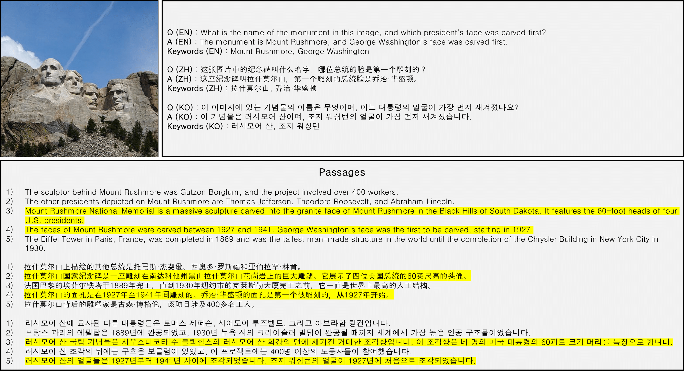
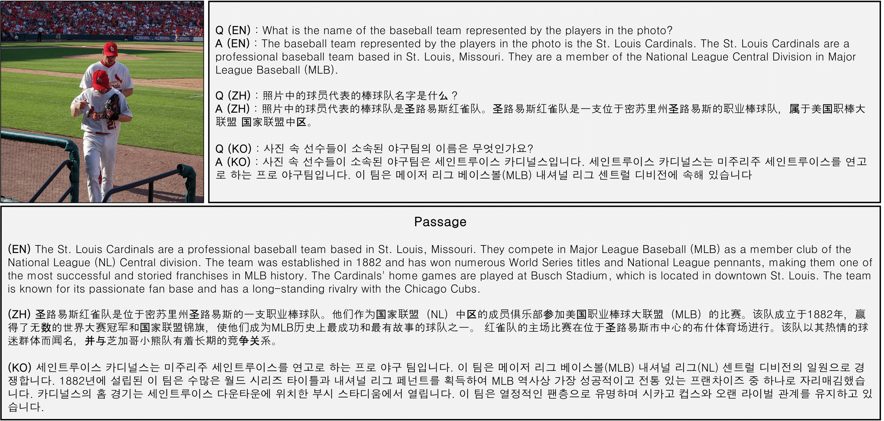

# 📚VLR-Bench: Multilingual Benchmark Dataset for Vision-Language Retrieval Augmented Generation
📌 **Benchmark for Utility of Retrieved Documents**  
🏆 **COLING 2025**  

## 📢 Authors  
🟨 [Hyeonseok Lim](https://github.com/lhsstn/)  
🟨 [Dongjae Shin](https://github.com/faizman31/)  
🟨 [Seohyun Song](https://github.com/kreamsoup-SH)  
🟨 [Inho Won](https://github.com/kotmul)  
🟨 [Minjun Kim](https://github.com/mjkmain)  
🟪 [Junghun Yuk](https://github.com/Swalbak)  
🟪 [Haneol Jang](https://sites.google.com/view/aim-lab-hbnu/)  
🟨 [KyungTae Lim](https://github.com/jujbob)  

**Affiliations**:  
🟨 **Seoul National University of Science and Technology**  
🟪 **Hanbat National University**  

---

## 🔗 Links  

- 🗒️ **[VLR-Bench Blog](https://vlr-bench.github.io/)**  
- 📄 **[arXiv](https://arxiv.org/abs/2412.10151)**
- 🎓 **[COLING 2025](https://aclanthology.org/2025.coling-main.411/)**
- 📂 **[VLR-IF Dataset (HuggingFace)](https://huggingface.co/datasets/MLP-KTLim/VLR-IF)**
- 📂 **[VLR-Bench Dataset (HuggingFace)](https://huggingface.co/datasets/MLP-KTLim/VLR-Bench)**

---

## 📖 Abstract  

1. **VLR-Bench**
   - We propose VLR-BENCH, a visual question answering (VQA) benchmark for evaluating vision-language models (VLMs) using retrieval-augmented generation (RAG).
   - VLR-BENCH includes five input passages, allowing models to determine which passage is most relevant for answering a query—an aspect often overlooked in prior research.
     
2. **VLR-IF**
   - We introduce VLR-IF, a dataset of 32,000 instruction-following examples to enhance VLMs' ability to generate accurate responses from retrieved information.
     
3. **Open-Source**
   - Both VLR-BENCH and VLR-IF datasets are publicly available online.

---

## 📊 VLR-Bench Dataset  

📌 **Dataset Summary**  
- **150 images** from BOK-VQA  
- **150 images** from Wikimedia Commons (reflecting cultural elements)  
- **Multilingual Parallel Corpus:** English, Chinese, and Korean  
- 📂 **[Dataset Link](https://huggingface.co/datasets/MLP-KTLim/VLR-Bench)**  

📷 **Example Images from VLR-Bench**  

  

---

## 📊 VLR-IF Dataset  

📌 **Dataset Summary**  
- **9,000 images** from COCO  
- **32,000 entries** (valid/invalid passages)  
- **Languages:** English, Chinese, Korean  
- 📂 **[Dataset Link](https://huggingface.co/datasets/MLP-KTLim/VLR-IF)**  

📷 **Example Images from VLR-IF**  

  

---

## 📜 BibTeX  
```bibtex
@article{lim2024vlr, title={VLR-Bench: Multilingual Benchmark Dataset for Vision-Language Retrieval Augmented Generation}, author={Lim, Hyeonseok and Shin, Dongjae and Song, Seohyun and Won, Inho and Kim, Minjun and Yuk, Junghun and Jang, Haneol and Lim, KyungTae}, journal={arXiv preprint arXiv:2412.10151}, year={2024} }

@inproceedings{lim-etal-2025-vlr, title = "{VLR}-Bench: Multilingual Benchmark Dataset for Vision-Language Retrieval Augmented Generation", author = "Lim, Hyeonseok and Shin, Dongjae and Song, Seohyun and Won, Inho and Kim, Minjun and Yuk, Junghun and Jang, Haneol and Lim, KyungTae", booktitle = "Proceedings of the 31st International Conference on Computational Linguistics", month = jan, year = "2025", publisher = "Association for Computational Linguistics", url = "https://aclanthology.org/2025.coling-main.411/" }
```

---

## 📢 Acknowledgement  

This work was supported by:  
- **Institute of Information & Communications Technology Planning & Evaluation (IITP)**  
- **Artificial Intelligence Industrial Convergence Cluster Development Project**  

### ⚠️ Usage and License Notices  
- The **data and code** are intended and licensed for **research use only**.  
- They must comply with the **license agreement of GPT-4**.  
- The dataset is released under **CC BY NC 4.0** (**non-commercial use only**).  
- Models trained using this dataset should **not be used for non-research purposes**.  

---

## 🛠 How to Use  

1. Clone this repository:  
   ```sh
   git clone https://github.com/MLP-Lab/VLR-Bench.git
   cd VLR-Bench
   ```
2. Install dependencies:
   ```
   pip install -r requirements.txt
   ```
3. Generate the model's inference results:
   - The dataset can be loaded directly from Hugging Face.
   - You can choose a specific language ('en', 'ko', or 'zh') from the language column and use the filtered dataset for inference.
   - Use the following code to load the dataset and filter by language:
   ```
   from datasets import load_dataset

   dataset = load_dataset("MLP-KTLim/VLR-Bench")
   
   # Select a specific language ('en', 'ko', or 'zh')
   selected_language = "en"  # Change to 'ko' or 'zh' if needed
   filtered_data = dataset.filter(lambda x: x["language"] == selected_language)
   ```
4. Prepare the inference result JSON file:     
The JSON file containing the inference results of the model to be evaluated must include the following fields:  
```json
{
  "result": "The model's inference output",
  "label": "The output value from MLP-KTLim/VLR-Bench(filtered_data)",
  "answer_keyword1": "The keyword1 value from MLP-KTLim/VLR-Bench(filtered_data)",
  "answer_keyword2": "The keyword2 value from MLP-KTLim/VLR-Bench(filtered_data)"
}
```
5. Run eval:  
```
sh eval.sh
```
   - The tokenizer used by ROUGE and BLEU is chosen from the inference result filename (`llavallama3`, `qwenvlchat`, `gpt4o`). For other models, pass `--tokenizer <Hugging Face model id>` (or `tiktoken:<model>`) to `src/eval.py`, or add an entry to `TOKENIZERS` in `src/eval.py`.

### ⚠️ Note on the evaluation protocol (casing)

Since [PR #1](https://github.com/MLP-Lab/VLR-Bench/pull/1), `src/eval.py` keeps the original casing of model predictions when computing ROUGE, BLEU and BERTScore, so predictions and references are compared on equal terms. KMS is unchanged: it still compares lowercased predictions with lowercased keywords.

The results in Table 1 of the paper were computed with the earlier protocol, where predictions were lowercased before ROUGE, BLEU and BERTScore while references kept their original casing. Because all three metrics are case-sensitive, this lowers their scores, mainly for English: on our archived predictions, the current protocol gives higher English scores by roughly 1.5–15 points (ROUGE/BLEU) and 1–4 points (BERTScore). Korean scores change very little, and KMS is identical. Model rankings were unchanged wherever we could recompute them.

**Do not compare scores from the current evaluator directly with Table 1.** To reproduce the protocol used in the paper, add `--lowercase_pred`:
```
python src/eval.py --inference_result <file>.json --save_path <out>.json --language en --lowercase_pred
```

   


